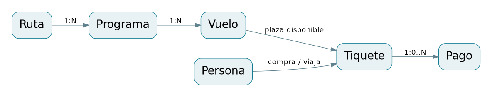
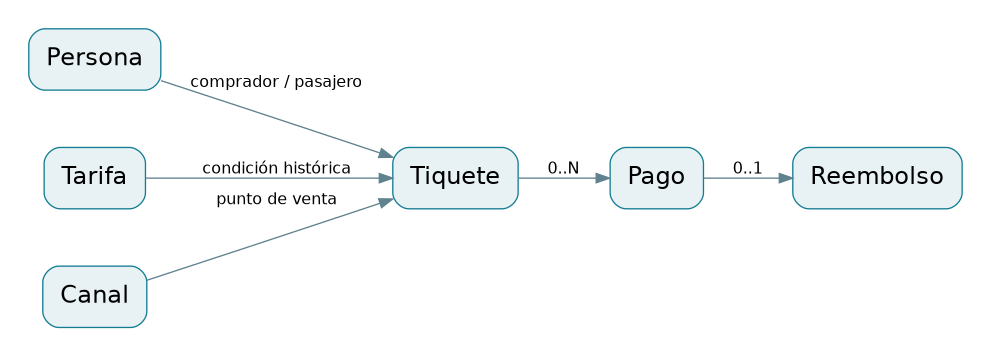
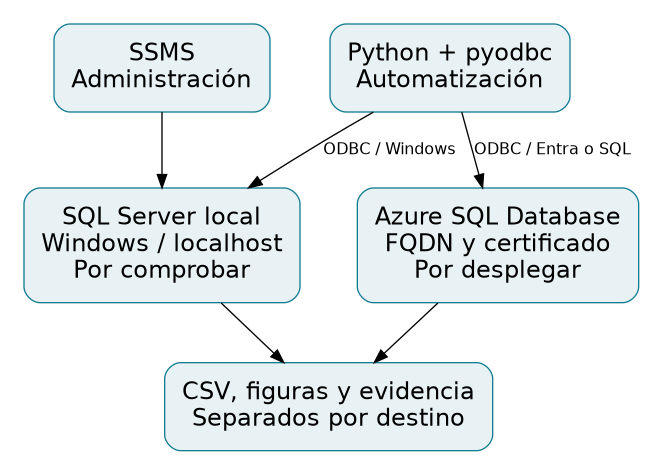

# Base de datos para una aerolínea comercial en Estados Unidos

**Producto Académico Colaborativo — PSMA00611**  
Curso: Gestión de datos y bases de datos con SQL  
Programa: Maestría en Ciencia de Datos  
Institución: [POR COMPLETAR; confirmar la institución del equipo]  
Docente: [POR COMPLETAR]  
Participantes activos: [POR COMPLETAR]  
Líder responsable de entrega: [POR COMPLETAR]  
Cohorte y fecha de entrega: [POR COMPLETAR]  
Fecha de preparación de esta versión: 26 de octubre de 2026 (America/Montevideo).

**Estado de la versión:** implementación preparada y verificación offline ejecutada. Ejecución de T-SQL, comprobación de la laptop, publicación autorizada en GitHub y despliegue Azure pendientes. No constituye evidencia de una base ya desplegada en la nube.

# 1. Resumen ejecutivo

Se diseñó una base de datos académica para administrar personas, empleados, rutas, programación, vuelos, plazas, ventas y movimientos financieros de una aerolínea nueva. El problema principal es asegurar que una plaza finita no se venda a dos personas, que las compras no exijan inscripción y que los informes separen contratos de venta, cobros y devoluciones. La solución utiliza SQL Server para persistencia e integridad y Python con pyodbc para generación, ejecución parametrizada y análisis reproducible.

El modelo físico consta de 19 tablas y 99 atributos documentados. Se entregan restricciones declarativas, un índice único de asiento activo, tres vistas, ocho procedimientos —incluido el auxiliar de bloqueo— y 18 consultas SELECT como meta de calidad propuesta por el proyecto. Las operaciones de venta, pago y cancelación son transaccionales. Los registros financieros usan USD y decimales; cada venta conserva sus condiciones históricas. El diseño lógico se normaliza y las redundancias físicas necesarias para FK compuestas y cálculos persistidos se reconocen expresamente.

En el entorno remoto se ejecutaron 21 pruebas de Python y se analizó la sintaxis de las 18 consultas con un parser parcial de T-SQL. La generación determinista produjo insumos para 32 vuelos y 896 solicitudes de tiquete. El motor SQL Server no pudo instalarse por restricciones de descarga; por consiguiente, no se presentan esos insumos como filas cargadas ni se inventan resultados de negocio. Se preparó una suite de 34 pruebas SQL, incluida concurrencia entre dos sesiones. Azure está preparado mediante guía y scripts, pero su ejecución real continúa pendiente. La contribución defendible de esta versión es una implementación integral y trazable, con límites de evidencia claramente definidos.

# 2. Problema, objetivos y alcance

La gestión de una aerolínea requiere relacionar identidades, recursos temporales, plazas, condiciones comerciales y pagos. Un registro monolítico que repita el precio del tiquete por cada pago produce sumas incorrectas; una verificación de disponibilidad sin transacción permite competir por el mismo asiento. La inscripción obligatoria también contradice la compra por personas no registradas establecida en la consigna. Estas situaciones justifican un modelo relacional y reglas verificables.

El objetivo general es desarrollar una base relacional reproducible que gestione reservas y movimientos financieros sin sobreventa y produzca información descriptiva conciliable. Los objetivos específicos son: identificar requisitos académicos y empresariales; normalizar entidades; implementar integridad y transacciones; integrar Python con parámetros; verificar operaciones críticas; y preparar el mismo esquema para Azure SQL Database. Cada objetivo se vincula a archivos y pruebas en la matriz del anexo.

El alcance incluye un pasajero y un vuelo por tiquete, dos cabinas, puntos físicos y web, tarifa versionada por ruta/cabina, una promoción no acumulable, pagos parciales o fallidos, cancelación previa a salida con devolución integral y asignación temporal de flota/tripulación. Quedan fuera órdenes de varios trayectos, conexiones, equipaje, mantenimiento, pasarelas reales, impuestos, reglas laborales y certificación FAA. No se modelan costos ni rentabilidad; el análisis se concentra en plazas, contratos y caja.

# 3. Requisitos y reglas de negocio

La consigna exige una base en la nube y la aplicación de requisitos, modelado, tablas, carga y consultas desde un lenguaje de programación. Las guías añaden GitHub y exposición de 10–15 diapositivas en 20 minutos, con todos los integrantes preparados para selección aleatoria. El líder entrega y la carátula incorpora solo participantes activos. La rúbrica considera información, análisis, conclusiones y estilo/gramática, hasta 5 puntos por criterio. Estos hechos se documentan con páginas en `docs/fuentes_y_discrepancias.md` y `docs/trazabilidad.csv`.

Se identificaron discrepancias: las guías incluyen en su p. 5 un resultado de aprendizaje sanitario ajeno al curso; difieren en la semana de avance y calendario, y la guía general tiene contradicciones internas en p. 23. No existe evidencia que declare vigente la versión llamada VIERNES. La rúbrica menciona un mínimo de páginas, pero ninguno de los cuatro documentos lo cuantifica. Se propone editorialmente 20–30 páginas totales, incluidos anexos, ajustadas por legibilidad, sujeto a confirmación docente; no se atribuye esa cifra a la consigna.

Los actores son administrador, planificador, agente/portal, comprador, atención al cliente, operaciones y analista. Los casos de uso principales son configurar recursos, concretar vuelos, asignar tripulantes, emitir tiquete, cobrar, cancelar, cambiar estados y consultar indicadores. Las 23 reglas RN de `docs/requisitos_y_reglas.md` precisan precondiciones, garantías y clasificación como requisito, interpretación o supuesto. Por ejemplo, el reembolso total y el margen de preparación de 45 minutos son supuestos académicos, no políticas acreditadas de una aerolínea.

# 4. Fundamentos conceptuales

El modelo relacional representa hechos en relaciones con claves y restricciones. Las claves primarias identifican filas, las candidatas previenen duplicación semántica y las claves foráneas mantienen referencias válidas. CHECK limita dominios dentro de la fila. Las reglas que involucran otras filas o tablas, como pagos que no excedan el saldo, necesitan una operación controlada con sincronización; no basta un CHECK que ignore el estado concurrente.

Una transacción agrupa cambios que deben confirmarse o revertirse como unidad. En este proyecto la cancelación debe devolver todos los pagos confirmados y liberar el asiento conjuntamente. El manejo TRY/CATCH, XACT_ABORT y THROW comunica el fallo y evita un estado parcial. Microsoft documenta las transacciones explícitas y su interacción con errores; esa semántica sustenta el diseño, aunque su verificación efectiva en el motor de destino permanece pendiente (Microsoft, s. f.-e).

Las vistas encapsulan consultas y reducen duplicación de lógica; no almacenan por sí solas una copia histórica de los resultados. La vista financiera agrega pagos y reembolsos por tiquete antes de unirlos con ventas. El precio final persistido es otro mecanismo: se calcula de forma determinista desde los importes históricos de una fila. Esta distinción evita confundir una representación consultable con un hecho materializado.

La integridad temporal requiere definir qué zona representa cada fecha. Un horario semanal se expresa en hora local del aeropuerto de origen, pero un instante de operación se conserva en UTC. AT TIME ZONE permite conversiones con reglas del sistema operativo, incluidos cambios estacionales (Microsoft, s. f.-a). Las reglas de negocio especifican el tratamiento de horas inexistentes o repetidas y la comparación por intervalos semiabiertos.

# 5. Modelado conceptual, lógico y físico



Persona es la entidad común para comprador y pasajero; Customer expresa inscripción opcional y Employee una relación laboral. Route representa el par de aeropuertos; Schedule añade recurrencia y Flight concreta fecha y avión. Separar estos conceptos permite varias programaciones y fechas sin duplicar los atributos de los aeropuertos. SalesChannel representa el lugar comercial y no se confunde con el aeropuerto de operación.

El inventario se deriva del mapa físico de asientos del avión y se crea al mismo tiempo que el vuelo. Cada Ticket referencia un asiento y una cabina válidos del inventario; el historial admite varios tiquetes cancelados para una plaza, pero solo uno activo. Payment modela intentos definitivos y Refund una reversión integral de un pago confirmado. StatusEvent conserva las transiciones realizadas mediante procedimientos.

El modelo lógico, sus cardinalidades y opcionalidad se desarrollan en `docs/modelado_normalizacion.md`; la fuente Mermaid es `docs/modelo_logico.mmd`. Las exportaciones globales permiten ampliar; para lectura impresa se entregan módulos de operaciones y ventas. El esquema físico y diccionario proceden de metadatos comunes, y una prueba offline verifica que todas las tablas, columnas y restricciones documentadas aparecen en el DDL. Esta comprobación estructural no valida todavía el catálogo real del motor.



# 6. Normalización y decisiones de diseño

La primera forma normal se cumple evitando listas de pagos, empleados o asientos en una celda. La segunda forma normal separa los hechos que dependen de la clave completa; CrewAssignment resuelve la relación N:M de tripulación. La tercera forma normal elimina dependencias transitivas descriptivas, por ejemplo, los datos del aeropuerto se conservan en Airport y no en cada vuelo o tiquete. El análisis de dependencias no se limita a insertar identificadores artificiales: también considera claves candidatas naturales y dependencias entre atributos no clave.

Entre las dependencias relevantes están AirportCode→nombre, ciudad y zonas; RouteId↔(origen,destino); ScheduleId→ruta, día, hora, duración y vigencia; (ScheduleId,FlightDate)→vuelo y asignación; (AircraftId,SeatNo)→cabina; y PaymentId/RequestKey→tiquete, importe, estado y fecha. La separación evita anomalías de actualización, inserción y borrado: un canal puede existir sin ventas, un cliente puede registrarse sin adquirir un tiquete y eliminar una reserva de prueba no borra la definición de una ruta.

Se distinguen el modelo lógico normalizado y las excepciones del físico. FlightSeat incluye AircraftId, dependiente de FlightId, para comprobar simultáneamente el avión del vuelo y el asiento real mediante FK compuestas. Ticket conserva CabinCode para restringir y consultar la cabina adquirida. Estas redundancias se declaran y no se presenta todo el físico como 3FN estricta. FinalPrice es una columna calculada persistida: elimina cálculos inconsistentes de clientes y no se actualiza manualmente.

OriginalPrice y DiscountPercent expresan las condiciones de una venta pasada. Su semántica temporal difiere de los catálogos actuales; conservarlos impide que una nueva tarifa reescriba contratos anteriores. La prueba de historia cambia una referencia dentro de una transacción de laboratorio y comprueba que el precio vendido no cambia, antes de revertir el ensayo. El detalle de dependencias y alternativas figura en el anexo de modelado.

# 7. Diccionario de datos

El diccionario del anexo A documenta los 99 atributos: definición, tipo, longitud/precisión, nulabilidad, valor predeterminado, dominio y restricciones por tabla. La versión CSV añade las claves y restricciones vinculadas a cada atributo y facilita su revisión. Todos los importes son `decimal(12,2)` en USD; porcentajes usan `decimal(5,2)`, instantes `datetime2(0)` y días de recurrencia ISO 1–7.

Las personas de muestra usan correos `example.invalid`. El correo es opcional y no se trata como identificador universal; comprador y pasajero se identifican por PersonId. No se incluyen documentos ni tarjetas. La nulabilidad distingue un dato opcional de un cero: ausencia de inscripción no es inscripción con identificador cero, y ausencia de pagos produce cobro cero por agregación explícita, no un pago inexistente fabricado.

# 8. Arquitectura local y en la nube



En Windows, SSMS administra y ejecuta consultas manuales; SQL Server almacena datos y aplica restricciones; Python conecta por ODBC, invoca procedimientos y exporta resultados. Se conoce por instrucción del usuario que el servicio local es MSSQLSERVER, pero no se observaron versión, edición, permisos, instalación de SSMS ni controlador. El entorno de elaboración es remoto y su localhost no representa la laptop. El diagnóstico entregado consulta estas condiciones sin reinstalar componentes ni activar servicios innecesarios.

La conexión local prioriza autenticación integrada, cifrado y validación de certificado. Se documenta una aceptación explícita del certificado autofirmado solo en desarrollo local, con su límite de identidad del servidor. Azure exige FQDN y validación del certificado, con Entra o autenticación SQL autorizada. Las cadenas se configuran externamente y sus componentes se escapan; nunca se guardan secretos en el repositorio (Microsoft, s. f.-c).

Azure SQL Database es el destino de nube previsto. La base debe crearse con autorización de gasto y conectividad limitada. Los scripts comunes se ejecutan dentro de ella; `USE master` y creación local de base quedan fuera del despliegue Azure. No hay recursos creados ni consultas observadas en la nube. `docs/azure.md` detalla pasos y evidencia necesaria; analyze comprueba EngineEdition=5 antes de registrar resultados de Azure.

# 9. Implementación SQL y Python

Los archivos numerados organizan esquema, índices, referencias, vistas, procedimientos, permisos, carga, consultas, DML seguro, auditoría y pruebas. El orden es 01→02→03→04→05→06→07; la carga 07 depende de los procedimientos. Python procesa GO como separador del cliente; no lo envía al motor. La instalación se agrupa en una transacción y rechaza un esquema ya existente. El reinicio destructivo está separado y bloqueado por defecto.

La emisión comprueba vuelo programado, fecha anterior a salida, pertenencia y disponibilidad del asiento, tarifa única vigente y promoción opcional. Conserva importes históricos y devuelve una reserva HELD. El pago registra un intento, limita la suma confirmada al saldo y actualiza PARTIAL/PAID. La cancelación conserva el tiquete, crea devoluciones por pagos confirmados y libera plaza mediante el índice filtrado. El procedimiento de vuelo controla transiciones, tripulación y cancelación colectiva.

Todas las escrituras de la API toman un bloqueo exclusivo de aplicación con propietario Transaction, documentado por Microsoft (s. f.-d). El bloqueo global es una decisión conservadora para el laboratorio: evita intercalaciones entre validación y escritura y facilita cancelaciones anidadas. El índice único filtrado de asiento activo agrega una barrera declarativa (Microsoft, s. f.-b). A cambio, se reduce el paralelismo; no se presenta como diseño de una plataforma comercial de alto tráfico.

Los procedimientos usan TRY/CATCH, XACT_ABORT y THROW. Si una operación anidada falla, revierte la transacción activa completa; el cliente no debe continuar como si una parte hubiera sido confirmada. Las claves UUID de emisión y pago permiten reintentar una solicitud idéntica sin duplicarla. El rol operativo tiene DML directo denegado y permisos de ejecución seleccionados; dbo sigue pudiendo eludir reglas procedimentales, límite reconocido y revisable mediante auditorías.

El paquete Python incluye CLI, configuración ODBC, generador determinista y exportador. Las entradas de negocio usan parámetros `?`; los archivos SQL a ejecutar pertenecen a una lista controlada. Las conexiones y cursores se cierran explícitamente. Analyze mantiene una transacción SERIALIZABLE y el mismo bloqueo del laboratorio para producir tablas coherentes, guarda hashes y genera figuras solo después de ejecutar consultas y verificar conciliaciones.

# 10. Datos sintéticos y metodología de validación

La semilla predeterminada es 6112026. El generador prepara seis aeropuertos de referencia, ocho pares de ruta, cuatro aviones académicos de 42 plazas cada uno (6 VIP y 36 ECO), 32 vuelos semanales y 896 solicitudes de tiquete en cuatro semanas. Estos son conteos del plan generado, no del catálogo SQL. Se incluyen personas inscritas y no inscritas, compradores distintos de pasajeros, canales físicos/web, descuentos, intentos fallidos, pagos parciales/múltiples, cancelaciones y estados operacionales variados.

El plan usa UTC para instantes y zonas IANA para convertir horarios locales, con equivalentes Windows almacenados para SQL. La muestra contiene un trayecto nocturno LAX→JFK que llega al día local siguiente. Los vuelos del mismo avión se organizan en ida/vuelta y evitan solapamiento con el margen previsto. Los casos inválidos no se mezclan con la carga válida: se ejecutan en la suite de pruebas de una base aislada cuyo nombre termina en _Test.

La validación tiene cuatro niveles: (a) insumos y código Python offline, (b) análisis sintáctico parcial de consultas, (c) pruebas reales de integridad/transacciones/permisos, y (d) concurrencia de sesiones independientes. Solo los dos primeros niveles se ejecutaron aquí. Las comprobaciones SQL cubren 19 auditorías de estado y 34 pruebas funcionales/concurrentes preparadas. Un resultado omitido se registra como pendiente, nunca como aprobado.

El volumen es deliberadamente pequeño para facilitar una demostración en laptop y ediciones limitadas. No se ha observado el tamaño real de una base ni se ha medido rendimiento del motor. Después del diagnóstico se puede ampliar semanas dentro de los límites documentados; un benchmark requeriría otro diseño experimental, medición de planes, índices y recursos.

# 11. Resultados y discusión

|Evidencia|Resultado observado|Archivo y alcance|
|---|---|---|
|Pruebas offline|21 superadas|evidence/offline_tests.txt; Python e insumos|
|Consultas SELECT|18 aceptadas por parser parcial|evidence/query_parse.json; no ejecución T-SQL|
|Generación determinista|32 vuelos y 896 solicitudes planeadas|data/generation_manifest.json y synthetic_plan.json|
|Suite SQL|34 omitidas por ausencia de motor|evidence/engine_tests_pending.txt; estado PENDIENTE|
|Controladores SQL Server ODBC del entorno|Lista vacía observada|evidence/environment_remote.json; no describe Windows|
|Motor remoto|Descargas oficiales bloqueadas; no iniciado|evidence/environment_remote.json|
|Laptop y Azure|No observados|Diagnóstico y despliegue pendientes|

No existen CSV de ejecución de ventas ni gráficos empíricos en esta versión. El anexo B vincula cada consulta con su pregunta, granularidad, filtros, fórmula y el resultado que deberá guardarse al ejecutar. Q01–Q02 y Q16 usan fecha de vuelo; Q03 y otros análisis financieros usan la cohorte de compra; Q04 usa fecha de movimiento de caja. Mezclar estas ventanas cambiaría la pregunta y puede aparentar una discrepancia inexistente.

Se definieron tres magnitudes distintas: ventas comerciales netas de contratos vigentes, cobros confirmados y reembolsos registrados. Las ventas no son utilidad ni ingreso contable devengado. Q15 comprueba que ventas netas menos caja neta menos saldo pendiente sea cero para la cohorte, y contrasta cobros de la vista con pagos agregados independientemente. Los cobros fallidos quedan fuera. Agregar pagos antes de unir evita multiplicar el precio del tiquete cuando existen varios abonos.

La ocupación reservada incluye HELD, PARTIAL y PAID porque todas consumen inventario; la ocupación pagada se informa aparte. El denominador es la capacidad por cabina del vuelo, excluyendo vuelos cancelados al resumir rutas. La ocupación de ruta se pondera por capacidad, no como media simple de porcentajes. La utilización de flota usa minutos programados sobre horas calendario del intervalo, sin afirmar disponibilidad técnica real.

Las pruebas offline respaldan coherencia de insumos, configuración y trazabilidad estructural. No permiten concluir que los procedimientos compilan, que los permisos funcionen como se diseñaron o que la concurrencia esté resuelta en el motor de destino. La prueba de dos sesiones para la última plaza, cuando se ejecute, deberá observar un único éxito y un rechazo 51014 con aforo completo. Hasta entonces es una hipótesis de implementación fundamentada, no un resultado experimental. Tampoco es lícito inferir comportamiento real de mercado a partir de patrones impuestos por el generador.

# 12. Seguridad, limitaciones y trabajo futuro

El repositorio excluye `.env`, archivos de base, respaldos y resultados potencialmente sensibles. La muestra usa identidades sintéticas y no almacena medios de pago reales. Los permisos operativos favorecen procedimientos con cadena de propiedad; la configuración de flota y tarifa queda en administración. El análisis describe la información de laboratorio, sin afirmar cumplimiento regulatorio ni operación comercial real.

Persisten límites técnicos: bloqueo global con baja concurrencia, ausencia de expiración automática de reservas, reloj histórico suministrado para reproducibilidad, una sola promoción, reembolso íntegro, avión fijo por vuelo y sin verificación de continuidad geográfica general. La tripulación mínima de un piloto y un auxiliar no es una norma aeronáutica; la no superposición no verifica habilitación, posicionamiento ni descanso. El registro de pagos/reembolsos es contable sintético, sin garantía de ejecución bancaria.

El trabajo futuro razonable es ejecutar y corregir las pruebas SQL en la laptop, acreditar nube, medir consultas y ajustar índices con planes observados. Para un sistema mayor se necesitarían bloqueos por recurso, recuperación de fallos de proveedor mediante outbox, auditoría externa, tiempos reales separados de programados, control de cambios de avión, reglas de posicionamiento, gestión de retención y pruebas de recuperación. No se incorporan modelos predictivos porque el objetivo es gestión relacional y no existe una necesidad ni un conjunto observacional que los justifique.

# 13. Conclusiones

1. Se cumplió el objetivo de especificación y diseño: los requisitos se relacionaron con fuentes verificadas y 46 filas de trazabilidad, distinguiendo obligaciones docentes, instrucciones actuales y supuestos académicos. Se detectaron discrepancias de calendario y falta del mínimo numérico de páginas, sin inventar resoluciones.
2. Se construyeron los archivos de implementación e integración: 19 tablas, 99 atributos documentados, vistas, procedimientos y 18 consultas. La separación de persona/registro y ruta/programación/vuelo responde a ambigüedades del dominio; la historia comercial se conserva y las excepciones físicas de normalización se justifican.
3. La evidencia ejecutada respalda reproducibilidad y verificaciones offline: 21 pruebas superadas y análisis sintáctico parcial de 18 SELECT. No acredita ejecución del motor ni resultados financieros; el cumplimiento del objetivo de validación SQL sigue pendiente de la suite preparada.
4. La nube está preparada documental y técnicamente, pero no desplegada. Para satisfacer el requisito académico es indispensable generar evidencia real en Azure SQL Database, además de verificar la laptop y completar la publicación autorizada del repositorio.

# 14. Recomendaciones

Ejecutar el diagnóstico Windows antes de instalar componentes, crear la base académica vacía y seguir README de principio a fin. Resolver cualquier fallo de la suite SQL en una base _Test y conservar comando, versión y resultado. Solo después regenerar CSV/figuras, incorporar las conclusiones empíricas al informe y desplegar en Azure con autorización de gasto. Confirmar guía vigente, calendario y extensión mínima con el docente. Completar la carátula y aportes con información real, autorizar GitHub y ensayar los 20 minutos con selección aleatoria de integrantes.

# 15. Referencias

Se propone APA 7 porque no se encontró otra norma de referencias explícita. No se trasladan automáticamente las ediciones/años inconsistentes de la bibliografía docente. La verificación técnica de las cinco páginas de Microsoft se registró contra su repositorio oficial; se cita s. f. en lugar de inventar fecha o edición.

Microsoft. (s. f.-a). *AT TIME ZONE (Transact-SQL).* Microsoft Learn. https://learn.microsoft.com/sql/t-sql/queries/at-time-zone-transact-sql

Microsoft. (s. f.-b). *CREATE INDEX (Transact-SQL).* Microsoft Learn. https://learn.microsoft.com/sql/t-sql/statements/create-index-transact-sql

Microsoft. (s. f.-c). *ODBC DSN and connection string keywords.* Microsoft Learn. https://learn.microsoft.com/sql/connect/odbc/dsn-connection-string-attribute

Microsoft. (s. f.-d). *sys.sp_getapplock (Transact-SQL).* Microsoft Learn. https://learn.microsoft.com/sql/relational-databases/system-stored-procedures/sp-getapplock-transact-sql

Microsoft. (s. f.-e). *Transactions (Transact-SQL).* Microsoft Learn. https://learn.microsoft.com/sql/t-sql/language-elements/transactions-transact-sql

*Producto académico colaborativo: Gestión de datos y bases de datos con SQL.* (s. f.). [Consigna y rúbrica proporcionadas por el usuario; archivo TXT].

*PSMA00611: Gestión de datos y bases de datos con SQL.* (s. f.). [Sílabo de curso proporcionado por el usuario].

Universidad Continental. (2023a). *Guía de actividades de aprendizaje: Gestión de datos y bases de datos con SQL* [Archivo PSMA00611 Guia de aprendizaje.pdf]. Escuela de Posgrado.

Universidad Continental. (2023b). *Guía de actividades de aprendizaje: Gestión de datos y bases de datos con SQL* [Archivo PSMA00611_Guía de aprendizaje_VIERNES.pdf]. Escuela de Posgrado.

# 16. Anexos e identificación de evidencia

A continuación se incorporan el diccionario completo, el catálogo de las 18 consultas y la matriz. Los diagramas editables y las exportaciones por módulo están en docs/. Las versiones originales de las fuentes se identifican mediante SHA-256 en `evidence/source_inventory.json`; no se publica su contenido completo. El guion de demostración y las 18 preguntas razonadas se encuentran en `docs/defensa.md` y las notas de diapositivas en `slides/notas.md`.

Al ejecutar consultas reales, incorporar `reports/local/resultados.md` y las dos figuras como nueva versión del capítulo 11. Citar las Qxx y el manifest correspondiente. La evidencia de Azure se añade por separado con su destino y fecha real. No cambiar PENDIENTE por APROBADO sin observar el resultado.


# Anexo A. Diccionario completo

# Diccionario completo de datos
Generado desde `docs/schema.json`; restricciones por tabla y columna. USD para todos los importes. La nulabilidad declarada de FinalPrice se registra por inferencia del catálogo; su expresión no produce NULL con operandos válidos.

## Airport
Aeropuerto de origen o destino; código de tres letras de referencia.

|Atributo|Tipo|Nulo|Predeterminado|Definición y dominio|
|---|---|---|---|---|
|AirportCode|char(3)|No|—|Código IATA. tres letras; referencia sintética del aeropuerto|
|Name|nvarchar(100)|No|—|Nombre del aeropuerto. texto no vacío|
|City|nvarchar(80)|No|—|Ciudad. texto|
|WindowsTZ|sysname|No|—|Zona horaria Windows usada por AT TIME ZONE. zona reconocida por sys.time_zone_info|
|IanaTZ|varchar(50)|No|—|Zona equivalente usada por Python. zona IANA reconocida por zoneinfo|

```sql
CONSTRAINT PK_Airport PRIMARY KEY (AirportCode)
CONSTRAINT CK_Airport_Name CHECK (LEN(LTRIM(RTRIM(Name)))>0)
```

## Cabin
Catálogo de cabinas.

|Atributo|Tipo|Nulo|Predeterminado|Definición y dominio|
|---|---|---|---|---|
|CabinCode|varchar(3)|No|—|Código de cabina. VIP o ECO|
|Name|nvarchar(30)|No|—|Denominación. nombre|

```sql
CONSTRAINT PK_Cabin PRIMARY KEY (CabinCode)
CONSTRAINT CK_Cabin_Code CHECK (CabinCode IN ('VIP','ECO'))
```

## Person
Persona física; comprador y pasajero son roles, sin exigir inscripción.

|Atributo|Tipo|Nulo|Predeterminado|Definición y dominio|
|---|---|---|---|---|
|PersonId|int|No|—|Identificador interno. entero positivo asignado por carga|
|FullName|nvarchar(120)|No|—|Nombre de la persona. texto no vacío|
|Email|varchar(160)|Sí|—|Contacto. correo opcional; no identificador universal|
|BirthDate|date|Sí|—|Fecha de nacimiento. fecha de nacimiento opcional|

```sql
CONSTRAINT PK_Person PRIMARY KEY (PersonId)
CONSTRAINT CK_Person_Id CHECK (PersonId>0)
CONSTRAINT CK_Person_Name CHECK (LEN(LTRIM(RTRIM(FullName)))>0)
```

## Customer
Inscripción opcional de una persona; especialización uno a cero o uno.

|Atributo|Tipo|Nulo|Predeterminado|Definición y dominio|
|---|---|---|---|---|
|PersonId|int|No|—|Persona inscrita. persona existente|
|RegisteredAt|datetime2(0)|No|SYSUTCDATETIME()|Momento de registro. instante UTC|

```sql
CONSTRAINT PK_Customer PRIMARY KEY (PersonId)
CONSTRAINT FK_Customer_Person FOREIGN KEY (PersonId) REFERENCES air.Person(PersonId)
```

## Employee
Empleado; se permiten personas que también son clientes.

|Atributo|Tipo|Nulo|Predeterminado|Definición y dominio|
|---|---|---|---|---|
|EmployeeId|int|No|—|Identificador de empleado. entero de carga|
|PersonId|int|No|—|Persona empleada. persona única|
|RoleCode|varchar(10)|No|—|Función académica única. PILOT o CABIN o SALES|
|Active|bit|No|1|Empleado habilitado. 0 o 1|

```sql
CONSTRAINT PK_Employee PRIMARY KEY (EmployeeId)
CONSTRAINT UQ_Employee_Person UNIQUE (PersonId)
CONSTRAINT FK_Employee_Person FOREIGN KEY (PersonId) REFERENCES air.Person(PersonId)
CONSTRAINT CK_Employee_Role CHECK (RoleCode IN ('PILOT','CABIN','SALES'))
```

## Aircraft
Avión; la capacidad se obtiene contando asientos, sin duplicar totales.

|Atributo|Tipo|Nulo|Predeterminado|Definición y dominio|
|---|---|---|---|---|
|AircraftId|int|No|—|Identificador del avión. entero de carga|
|Registration|varchar(12)|No|—|Matrícula. matrícula sintética única|
|Model|nvarchar(60)|No|—|Descripción de aeronave. modelo académico|
|Active|bit|No|1|Aeronave habilitada. 0 o 1|

```sql
CONSTRAINT PK_Aircraft PRIMARY KEY (AircraftId)
CONSTRAINT UQ_Aircraft_Reg UNIQUE (Registration)
```

## AircraftSeat
Configuración inmutable durante la muestra; una fila por asiento real.

|Atributo|Tipo|Nulo|Predeterminado|Definición y dominio|
|---|---|---|---|---|
|AircraftId|int|No|—|Avión al que pertenece. avión existente|
|SeatNo|varchar(4)|No|—|Etiqueta de asiento. asiento dentro del avión|
|CabinCode|varchar(3)|No|—|Cabina del asiento. VIP o ECO|

```sql
CONSTRAINT PK_AircraftSeat PRIMARY KEY (AircraftId,SeatNo)
CONSTRAINT UQ_AircraftSeat_Cabin UNIQUE (AircraftId,SeatNo,CabinCode)
CONSTRAINT FK_AircraftSeat_Aircraft FOREIGN KEY (AircraftId) REFERENCES air.Aircraft(AircraftId)
CONSTRAINT FK_AircraftSeat_Cabin FOREIGN KEY (CabinCode) REFERENCES air.Cabin(CabinCode)
```

## Route
Par ordenado de aeropuertos; la recurrencia se normaliza en Schedule.

|Atributo|Tipo|Nulo|Predeterminado|Definición y dominio|
|---|---|---|---|---|
|RouteId|int|No|—|Identificador de ruta. entero de carga|
|OriginCode|char(3)|No|—|Origen. aeropuerto existente|
|DestinationCode|char(3)|No|—|Destino. aeropuerto distinto del origen|

```sql
CONSTRAINT PK_Route PRIMARY KEY (RouteId)
CONSTRAINT UQ_Route_Pair UNIQUE (OriginCode,DestinationCode)
CONSTRAINT FK_Route_Origin FOREIGN KEY (OriginCode) REFERENCES air.Airport(AirportCode)
CONSTRAINT FK_Route_Destination FOREIGN KEY (DestinationCode) REFERENCES air.Airport(AirportCode)
CONSTRAINT CK_Route_Different CHECK (OriginCode<>DestinationCode)
```

## Schedule
Patrón recurrente semanal de una ruta, con hora local del origen.

|Atributo|Tipo|Nulo|Predeterminado|Definición y dominio|
|---|---|---|---|---|
|ScheduleId|int|No|—|Identificador del patrón. entero de carga|
|RouteId|int|No|—|Ruta programada. ruta existente|
|IsoWeekday|tinyint|No|—|Día ISO de salida. 1 lunes a 7 domingo|
|DepartureLocal|time(0)|No|—|Hora local prevista. 00:00:00 a 23:59:59|
|DurationMinutes|smallint|No|—|Duración programada en minutos. 30 a 900|
|ValidFrom|date|No|—|Primer día de vigencia. incluida|
|ValidTo|date|No|—|Fin de vigencia. excluida; posterior a ValidFrom|

```sql
CONSTRAINT PK_Schedule PRIMARY KEY (ScheduleId)
CONSTRAINT FK_Schedule_Route FOREIGN KEY (RouteId) REFERENCES air.Route(RouteId)
CONSTRAINT CK_Schedule_Day CHECK (IsoWeekday BETWEEN 1 AND 7)
CONSTRAINT CK_Schedule_Duration CHECK (DurationMinutes BETWEEN 30 AND 900)
CONSTRAINT CK_Schedule_Validity CHECK (ValidFrom<ValidTo)
CONSTRAINT UQ_Schedule_Pattern UNIQUE (RouteId,IsoWeekday,DepartureLocal,ValidFrom)
```

## Flight
Instancia fechada; se crea por procedimiento a partir de Schedule.

|Atributo|Tipo|Nulo|Predeterminado|Definición y dominio|
|---|---|---|---|---|
|FlightId|int|No|—|Identificador del vuelo. entero de carga|
|ScheduleId|int|No|—|Patrón de origen. programación existente|
|AircraftId|int|No|—|Aeronave asignada de forma fija. avión existente|
|FlightDate|date|No|—|Fecha de operación en el origen. fecha local de salida|
|DepartureUtc|datetime2(0)|No|—|Salida programada. instante UTC|
|ArrivalUtc|datetime2(0)|No|—|Llegada programada. posterior a salida|
|Status|varchar(10)|No|'SCHEDULED'|Estado operacional. SCHEDULED BOARDING DEPARTED ARRIVED CANCELLED|

```sql
CONSTRAINT PK_Flight PRIMARY KEY (FlightId)
CONSTRAINT UQ_Flight_Aircraft UNIQUE (FlightId,AircraftId)
CONSTRAINT UQ_Flight_Instance UNIQUE (ScheduleId,FlightDate)
CONSTRAINT FK_Flight_Schedule FOREIGN KEY (ScheduleId) REFERENCES air.Schedule(ScheduleId)
CONSTRAINT FK_Flight_Aircraft FOREIGN KEY (AircraftId) REFERENCES air.Aircraft(AircraftId)
CONSTRAINT CK_Flight_Times CHECK (DepartureUtc<ArrivalUtc)
CONSTRAINT CK_Flight_Status CHECK (Status IN ('SCHEDULED','BOARDING','DEPARTED','ARRIVED','CANCELLED'))
```

## FlightSeat
Inventario de plazas; copia controlada de la configuración del avión.

|Atributo|Tipo|Nulo|Predeterminado|Definición y dominio|
|---|---|---|---|---|
|FlightId|int|No|—|Vuelo. vuelo existente|
|AircraftId|int|No|—|Avión; redundancia controlada por FK compuesta. debe coincidir con avión de Flight|
|SeatNo|varchar(4)|No|—|Asiento ofrecido. asiento físico del avión|
|CabinCode|varchar(3)|No|—|Cabina ofrecida. igual a cabina física|

```sql
CONSTRAINT PK_FlightSeat PRIMARY KEY (FlightId,SeatNo)
CONSTRAINT UQ_FlightSeat_Cabin UNIQUE (FlightId,SeatNo,CabinCode)
CONSTRAINT FK_FlightSeat_Flight FOREIGN KEY (FlightId,AircraftId) REFERENCES air.Flight(FlightId,AircraftId)
CONSTRAINT FK_FlightSeat_Physical FOREIGN KEY (AircraftId,SeatNo,CabinCode) REFERENCES air.AircraftSeat(AircraftId,SeatNo,CabinCode)
```

## CrewAssignment
Asignación temporal de empleado a vuelo; no se modela certificación FAA.

|Atributo|Tipo|Nulo|Predeterminado|Definición y dominio|
|---|---|---|---|---|
|FlightId|int|No|—|Vuelo atendido. vuelo existente|
|EmployeeId|int|No|—|Tripulante. empleado activo PILOT o CABIN|

```sql
CONSTRAINT PK_CrewAssignment PRIMARY KEY (FlightId,EmployeeId)
CONSTRAINT FK_CrewAssignment_Flight FOREIGN KEY (FlightId) REFERENCES air.Flight(FlightId)
CONSTRAINT FK_CrewAssignment_Employee FOREIGN KEY (EmployeeId) REFERENCES air.Employee(EmployeeId)
```

## SalesChannel
Punto físico o web de venta, distinto de los aeropuertos.

|Atributo|Tipo|Nulo|Predeterminado|Definición y dominio|
|---|---|---|---|---|
|ChannelId|int|No|—|Identificador de canal. entero de carga|
|Name|nvarchar(80)|No|—|Nombre del punto de venta. nombre|
|Kind|varchar(8)|No|—|Tipo de canal. PHYSICAL o WEB|
|Address|nvarchar(200)|Sí|—|Dirección postal sintética. obligatoria solo en PHYSICAL|
|Url|varchar(200)|Sí|—|URL de demostración. obligatoria solo en WEB; https|
|AirportCode|char(3)|Sí|—|Aeropuerto asociado. aeropuerto opcional para oficina física|

```sql
CONSTRAINT PK_SalesChannel PRIMARY KEY (ChannelId)
CONSTRAINT FK_SalesChannel_Airport FOREIGN KEY (AirportCode) REFERENCES air.Airport(AirportCode)
CONSTRAINT CK_SalesChannel_Kind CHECK ((Kind='PHYSICAL' AND Address IS NOT NULL AND Url IS NULL) OR (Kind='WEB' AND Address IS NULL AND Url IS NOT NULL AND Url LIKE 'https://%' AND AirportCode IS NULL))
```

## Fare
Versión de tarifa por ruta y cabina; vigencia por instante de compra UTC.

|Atributo|Tipo|Nulo|Predeterminado|Definición y dominio|
|---|---|---|---|---|
|FareId|int|No|—|Versión tarifaria. entero de carga|
|RouteId|int|No|—|Ruta tarifada. ruta existente|
|CabinCode|varchar(3)|No|—|Cabina tarifada. VIP o ECO|
|ValidFrom|datetime2(0)|No|—|Inicio de venta. incluido UTC|
|ValidTo|datetime2(0)|No|—|Fin de venta. excluido UTC|
|Price|decimal(12,2)|No|—|Precio original antes de descuento. mayor que 0; USD|

```sql
CONSTRAINT PK_Fare PRIMARY KEY (FareId)
CONSTRAINT FK_Fare_Route FOREIGN KEY (RouteId) REFERENCES air.Route(RouteId)
CONSTRAINT FK_Fare_Cabin FOREIGN KEY (CabinCode) REFERENCES air.Cabin(CabinCode)
CONSTRAINT CK_Fare_Validity CHECK (ValidFrom<ValidTo)
CONSTRAINT CK_Fare_Price CHECK (Price>0)
```

## Discount
Promoción porcentual global académica; como máximo una por tiquete.

|Atributo|Tipo|Nulo|Predeterminado|Definición y dominio|
|---|---|---|---|---|
|DiscountId|int|No|—|Identificador de descuento. entero de carga|
|Code|varchar(20)|No|—|Código promocional. único|
|PercentValue|decimal(5,2)|No|—|Porcentaje de descuento. mayor que 0 y hasta 30|
|ValidFrom|datetime2(0)|No|—|Inicio de vigencia. incluido UTC|
|ValidTo|datetime2(0)|No|—|Fin de vigencia. excluido UTC|

```sql
CONSTRAINT PK_Discount PRIMARY KEY (DiscountId)
CONSTRAINT UQ_Discount_Code UNIQUE (Code)
CONSTRAINT CK_Discount_Percent CHECK (PercentValue>0 AND PercentValue<=30)
CONSTRAINT CK_Discount_Validity CHECK (ValidFrom<ValidTo)
```

## Ticket
Contrato para una persona y un asiento de un vuelo; importes históricos USD.

|Atributo|Tipo|Nulo|Predeterminado|Definición y dominio|
|---|---|---|---|---|
|TicketId|bigint IDENTITY(1,1)|No|—|Identificador del tiquete. autonumérico|
|RequestKey|uniqueidentifier|No|—|Identificador estable del intento de compra. único; clave de idempotencia de emisión|
|FlightId|int|No|—|Vuelo adquirido. vuelo existente|
|SeatNo|varchar(4)|No|—|Asiento asignado. asiento disponible|
|CabinCode|varchar(3)|No|—|Cabina adquirida. coincide con inventario|
|PassengerId|int|No|—|Persona que viaja. persona con o sin registro|
|BuyerId|int|No|—|Persona que compra. persona con o sin registro|
|ChannelId|int|No|—|Canal de venta. canal existente|
|FareId|int|No|—|Versión de referencia. tarifa única vigente al vender|
|DiscountId|int|Sí|—|Promoción aplicada. promoción vigente opcional|
|OriginalPrice|decimal(12,2)|No|—|Precio original histórico. positivo USD; copia al vender|
|DiscountPercent|decimal(5,2)|No|0|Porcentaje histórico no acumulable. 0 a 30|
|SoldAt|datetime2(0)|No|SYSUTCDATETIME()|Fecha de venta. instante de compra UTC anterior a salida|
|Status|varchar(10)|No|'HELD'|Estado de reserva y cobro. HELD PARTIAL PAID CANCELLED|
|CancelledAt|datetime2(0)|Sí|—|Instante de cancelación. UTC; solo CANCELLED|
|CancelReason|nvarchar(200)|Sí|—|Motivo de cancelación. solo CANCELLED|
|FinalPrice|decimal(12,2) COMPUTED PERSISTED|Sí|—|Precio final histórico calculado; el catálogo puede inferir nulabilidad aunque la expresión es total. ROUND(OriginalPrice*(1-DiscountPercent/100),2); operandos NOT NULL|

```sql
CONSTRAINT PK_Ticket PRIMARY KEY (TicketId)
CONSTRAINT UQ_Ticket_Request UNIQUE (RequestKey)
CONSTRAINT FK_Ticket_Seat FOREIGN KEY (FlightId,SeatNo,CabinCode) REFERENCES air.FlightSeat(FlightId,SeatNo,CabinCode)
CONSTRAINT FK_Ticket_Passenger FOREIGN KEY (PassengerId) REFERENCES air.Person(PersonId)
CONSTRAINT FK_Ticket_Buyer FOREIGN KEY (BuyerId) REFERENCES air.Person(PersonId)
CONSTRAINT FK_Ticket_Channel FOREIGN KEY (ChannelId) REFERENCES air.SalesChannel(ChannelId)
CONSTRAINT FK_Ticket_Fare FOREIGN KEY (FareId) REFERENCES air.Fare(FareId)
CONSTRAINT FK_Ticket_Discount FOREIGN KEY (DiscountId) REFERENCES air.Discount(DiscountId)
CONSTRAINT CK_Ticket_Price CHECK (OriginalPrice>0 AND DiscountPercent BETWEEN 0 AND 30)
CONSTRAINT CK_Ticket_Promotion CHECK ((DiscountId IS NULL AND DiscountPercent=0) OR (DiscountId IS NOT NULL AND DiscountPercent>0))
CONSTRAINT CK_Ticket_Status CHECK (Status IN ('HELD','PARTIAL','PAID','CANCELLED'))
CONSTRAINT CK_Ticket_Cancel CHECK ((Status='CANCELLED' AND CancelledAt IS NOT NULL AND CancelReason IS NOT NULL AND CancelledAt>=SoldAt) OR (Status<>'CANCELLED' AND CancelledAt IS NULL AND CancelReason IS NULL))
```

## Payment
Intento de cobro; solo confirmado o fallido, sin pasarela real.

|Atributo|Tipo|Nulo|Predeterminado|Definición y dominio|
|---|---|---|---|---|
|PaymentId|bigint IDENTITY(1,1)|No|—|Identificador de pago. autonumérico|
|TicketId|bigint|No|—|Tiquete abonado. tiquete existente|
|RequestKey|uniqueidentifier|No|—|Clave de operación de cobro. único e idempotente|
|Amount|decimal(12,2)|No|—|Importe del intento. mayor que 0 USD|
|Status|varchar(9)|No|—|Resultado definitivo simulado. CONFIRMED o FAILED|
|Method|varchar(10)|No|—|Medio de pago sin datos bancarios. CARD CASH TRANSFER|
|PaidAt|datetime2(0)|No|SYSUTCDATETIME()|Fecha de intento. UTC; no anterior a venta|

```sql
CONSTRAINT PK_Payment PRIMARY KEY (PaymentId)
CONSTRAINT UQ_Payment_Request UNIQUE (RequestKey)
CONSTRAINT FK_Payment_Ticket FOREIGN KEY (TicketId) REFERENCES air.Ticket(TicketId)
CONSTRAINT CK_Payment_Amount CHECK (Amount>0)
CONSTRAINT CK_Payment_Status CHECK (Status IN ('CONFIRMED','FAILED'))
CONSTRAINT CK_Payment_Method CHECK (Method IN ('CARD','CASH','TRANSFER'))
```

## Refund
Reembolso contable total de un pago confirmado al cancelar.

|Atributo|Tipo|Nulo|Predeterminado|Definición y dominio|
|---|---|---|---|---|
|RefundId|bigint IDENTITY(1,1)|No|—|Identificador del reembolso. autonumérico|
|PaymentId|bigint|No|—|Pago revertido íntegramente. pago confirmado; uno por pago|
|Amount|decimal(12,2)|No|—|Importe devuelto. mayor que 0 USD|
|RefundedAt|datetime2(0)|No|SYSUTCDATETIME()|Instante del registro. UTC posterior o igual a pago|

```sql
CONSTRAINT PK_Refund PRIMARY KEY (RefundId)
CONSTRAINT UQ_Refund_Payment UNIQUE (PaymentId)
CONSTRAINT FK_Refund_Payment FOREIGN KEY (PaymentId) REFERENCES air.Payment(PaymentId)
CONSTRAINT CK_Refund_Amount CHECK (Amount>0)
```

## StatusEvent
Auditoría de transiciones; entidad por referencias excluyentes.

|Atributo|Tipo|Nulo|Predeterminado|Definición y dominio|
|---|---|---|---|---|
|EventId|bigint IDENTITY(1,1)|No|—|Identificador de evento. autonumérico|
|TicketId|bigint|Sí|—|Tiquete afectado. tiquete o vuelo; exactamente uno|
|FlightId|int|Sí|—|Vuelo afectado. tiquete o vuelo; exactamente uno|
|FromStatus|varchar(10)|Sí|—|Estado previo. nulo para creación|
|ToStatus|varchar(10)|No|—|Nuevo estado. estado destino de la entidad|
|ChangedAt|datetime2(0)|No|SYSUTCDATETIME()|Momento del cambio. UTC del evento académico|
|Actor|sysname|No|SUSER_SNAME()|Usuario que ejecutó. principal SQL|

```sql
CONSTRAINT PK_StatusEvent PRIMARY KEY (EventId)
CONSTRAINT FK_StatusEvent_Ticket FOREIGN KEY (TicketId) REFERENCES air.Ticket(TicketId)
CONSTRAINT FK_StatusEvent_Flight FOREIGN KEY (FlightId) REFERENCES air.Flight(FlightId)
CONSTRAINT CK_StatusEvent_Entity CHECK ((TicketId IS NOT NULL AND FlightId IS NULL) OR (TicketId IS NULL AND FlightId IS NOT NULL))
```


# Anexo B. Consultas y análisis reproducible

# Catálogo de consultas

Cada archivo Qxx se ejecuta desde Python con `@Start` y `@End` parametrizados. Intervalos semiabiertos. Estado actual de la carga, sin inferir resultados no observados.


## Q01. Ocupación por vuelo y cabina

Pregunta y utilidad: Ocupación por vuelo y cabina. Compara ocupación reservada y pagada; no equivale a pasajeros efectivamente transportados.

Granularidad: vuelo × cabina. Filtros: FlightDate en [Start,End); excluye vuelos cancelados.

Fórmula: 100 × plazas reservadas activas / plazas ofrecidas.

```sql

SELECT FlightId,RouteId,FlightDate,CabinCode,Capacity,Reserved,PaidSeats,Available,OccupancyPercent
FROM air.vOccupancy WHERE FlightDate>=@Start AND FlightDate<@End AND Status<>'CANCELLED' ORDER BY FlightId,CabinCode;

```

Resultado ejecutado: PENDIENTE: requiere motor SQL Server; no existe resultado observado. Al ejecutar, se guarda en `reports/local/Q01.csv` o `reports/azure/Q01.csv` y su interpretación se completa en el resumen generado.


## Q02. Ocupación ponderada por ruta y cabina

Pregunta y utilidad: Ocupación ponderada por ruta y cabina. Ponderar por capacidad evita promediar porcentajes de vuelos con denominadores distintos.

Granularidad: ruta × cabina. Filtros: FlightDate; excluye cancelados.

Fórmula: 100 × SUM(Reserved) / SUM(Capacity).

```sql

SELECT RouteId,CabinCode,SUM(Capacity) Capacity,SUM(Reserved) Reserved,
CAST(100.0*SUM(Reserved)/NULLIF(SUM(Capacity),0) AS decimal(6,2)) OccupancyPercent
FROM air.vOccupancy WHERE FlightDate>=@Start AND FlightDate<@End AND Status<>'CANCELLED'
GROUP BY RouteId,CabinCode ORDER BY RouteId,CabinCode;

```

Resultado ejecutado: PENDIENTE: requiere motor SQL Server; no existe resultado observado. Al ejecutar, se guarda en `reports/local/Q02.csv` o `reports/azure/Q02.csv` y su interpretación se completa en el resumen generado.


## Q03. Ventas comerciales y cobros de la cohorte

Pregunta y utilidad: Ventas comerciales y cobros de la cohorte. Ventas netas son contratos vigentes; no son ingreso contable devengado ni utilidad.

Granularidad: cohorte de fecha de venta. Filtros: SoldAt en [Start,End); estado actual cargado.

Fórmula: emitido bruto, neto de cancelación, cobrado y reembolsado se agregan por tiquete.

```sql

SELECT COUNT_BIG(*) Tickets,COALESCE(SUM(FinalPrice),0) GrossIssued,COALESCE(SUM(NetSales),0) NetSales,
COALESCE(SUM(Collected),0) Collected,COALESCE(SUM(Refunded),0) Refunded,COALESCE(SUM(NetCash),0) NetCash,COALESCE(SUM(Outstanding),0) Outstanding
FROM air.vTicketFinance WHERE SoldAt>=@Start AND SoldAt<@End;

```

Resultado ejecutado: PENDIENTE: requiere motor SQL Server; no existe resultado observado. Al ejecutar, se guarda en `reports/local/Q03.csv` o `reports/azure/Q03.csv` y su interpretación se completa en el resumen generado.


## Q04. Flujo de caja por fecha de movimiento

Pregunta y utilidad: Flujo de caja por fecha de movimiento. Los movimientos de caja y las cohortes de venta tienen calendarios distintos.

Granularidad: día UTC de pago o reembolso. Filtros: PaidAt y RefundedAt en [Start,End).

Fórmula: cobros confirmados − reembolsos.

```sql

WITH movements AS (
SELECT CAST(PaidAt AS date) DayUtc,Amount Collected,CAST(0 AS decimal(12,2)) Refunded FROM air.Payment WHERE Status='CONFIRMED' AND PaidAt>=@Start AND PaidAt<@End
UNION ALL SELECT CAST(RefundedAt AS date),0,Amount FROM air.Refund WHERE RefundedAt>=@Start AND RefundedAt<@End)
SELECT DayUtc,SUM(Collected) Collected,SUM(Refunded) Refunded,SUM(Collected-Refunded) NetCash FROM movements GROUP BY DayUtc ORDER BY DayUtc;

```

Resultado ejecutado: PENDIENTE: requiere motor SQL Server; no existe resultado observado. Al ejecutar, se guarda en `reports/local/Q04.csv` o `reports/azure/Q04.csv` y su interpretación se completa en el resumen generado.


## Q05. Tiquetes con saldo pendiente

Pregunta y utilidad: Tiquetes con saldo pendiente. Prioriza cobros pendientes; el saldo es el estado actual, sin reconstrucción histórica al corte.

Granularidad: tiquete. Filtros: SoldAt y Outstanding>0.

Fórmula: FinalPrice − cobros confirmados, cero si cancelado.

```sql

SELECT TicketId,FlightId,Status,FinalPrice,Collected,Outstanding FROM air.vTicketFinance
WHERE SoldAt>=@Start AND SoldAt<@End AND Outstanding>0 ORDER BY Outstanding DESC,TicketId;

```

Resultado ejecutado: PENDIENTE: requiere motor SQL Server; no existe resultado observado. Al ejecutar, se guarda en `reports/local/Q05.csv` o `reports/azure/Q05.csv` y su interpretación se completa en el resumen generado.


## Q06. Conciliación de reembolsos

Pregunta y utilidad: Conciliación de reembolsos. Un pago fallido no se devuelve. Un valor distinto de cero es una inconsistencia.

Granularidad: tiquete cancelado. Filtros: SoldAt y estado CANCELLED.

Fórmula: Collected − Refunded debe ser cero.

```sql

SELECT TicketId,Collected,Refunded,NetCash FROM air.vTicketFinance
WHERE SoldAt>=@Start AND SoldAt<@End AND Status='CANCELLED' ORDER BY TicketId;

```

Resultado ejecutado: PENDIENTE: requiere motor SQL Server; no existe resultado observado. Al ejecutar, se guarda en `reports/local/Q06.csv` o `reports/azure/Q06.csv` y su interpretación se completa en el resumen generado.


## Q07. Precio medio y descuento efectivo

Pregunta y utilidad: Precio medio y descuento efectivo. El descuento efectivo se pondera por importe, no por promedio simple de porcentajes.

Granularidad: cabina. Filtros: SoldAt; tiquetes no cancelados.

Fórmula: AVG(FinalPrice); 100 × SUM(OriginalPrice−FinalPrice)/SUM(OriginalPrice).

```sql

SELECT CabinCode,COUNT(*) Tickets,AVG(OriginalPrice) MeanOriginal,AVG(FinalPrice) MeanFinal,
CAST(100.0*SUM(OriginalPrice-FinalPrice)/NULLIF(SUM(OriginalPrice),0) AS decimal(6,2)) EffectiveDiscountPercent
FROM air.Ticket WHERE SoldAt>=@Start AND SoldAt<@End AND Status<>'CANCELLED' GROUP BY CabinCode ORDER BY CabinCode;

```

Resultado ejecutado: PENDIENTE: requiere motor SQL Server; no existe resultado observado. Al ejecutar, se guarda en `reports/local/Q07.csv` o `reports/azure/Q07.csv` y su interpretación se completa en el resumen generado.


## Q08. Ventas por canal, incluidos canales sin venta

Pregunta y utilidad: Ventas por canal, incluidos canales sin venta. Los canales sin actividad aparecen con cero; no se interpreta ausencia de datos como información desconocida.

Granularidad: canal. Filtros: SoldAt en condición del LEFT JOIN.

Fórmula: SUM de importes por tiquete.

```sql

SELECT c.ChannelId,c.Name,c.Kind,COUNT(t.TicketId) Tickets,COALESCE(SUM(t.NetSales),0) NetSales,COALESCE(SUM(t.NetCash),0) NetCash
FROM air.SalesChannel c LEFT JOIN air.vTicketFinance t ON t.ChannelId=c.ChannelId AND t.SoldAt>=@Start AND t.SoldAt<@End
GROUP BY c.ChannelId,c.Name,c.Kind ORDER BY c.ChannelId;

```

Resultado ejecutado: PENDIENTE: requiere motor SQL Server; no existe resultado observado. Al ejecutar, se guarda en `reports/local/Q08.csv` o `reports/azure/Q08.csv` y su interpretación se completa en el resumen generado.


## Q09. Viajes según inscripción del pasajero al vender

Pregunta y utilidad: Viajes según inscripción del pasajero al vender. Se cuentan tiquetes, no personas únicas; comprador y pasajero son roles distintos.

Granularidad: inscrito o sin registro al vender. Filtros: SoldAt; tiquetes activos.

Fórmula: Customer.RegisteredAt <= SoldAt.

```sql

SELECT CASE WHEN c.PersonId IS NOT NULL AND c.RegisteredAt<=t.SoldAt THEN 'REGISTERED' ELSE 'UNREGISTERED' END Registration,
COUNT(*) Tickets,COUNT(DISTINCT t.PassengerId) DistinctPassengers FROM air.Ticket t LEFT JOIN air.Customer c ON c.PersonId=t.PassengerId
WHERE t.SoldAt>=@Start AND t.SoldAt<@End AND t.Status<>'CANCELLED'
GROUP BY CASE WHEN c.PersonId IS NOT NULL AND c.RegisteredAt<=t.SoldAt THEN 'REGISTERED' ELSE 'UNREGISTERED' END;

```

Resultado ejecutado: PENDIENTE: requiere motor SQL Server; no existe resultado observado. Al ejecutar, se guarda en `reports/local/Q09.csv` o `reports/azure/Q09.csv` y su interpretación se completa en el resumen generado.


## Q10. Cancelaciones por ruta

Pregunta y utilidad: Cancelaciones por ruta. La tasa descriptiva sintetiza las políticas sintéticas; no explica causas del mercado.

Granularidad: ruta. Filtros: SoldAt de la cohorte.

Fórmula: 100 × cancelados / emitidos.

```sql

SELECT s.RouteId,COUNT(*) Issued,SUM(CASE WHEN t.Status='CANCELLED' THEN 1 ELSE 0 END) Cancelled,
CAST(100.0*SUM(CASE WHEN t.Status='CANCELLED' THEN 1 ELSE 0 END)/COUNT(*) AS decimal(6,2)) CancellationPercent
FROM air.Ticket t JOIN air.Flight f ON f.FlightId=t.FlightId JOIN air.Schedule s ON s.ScheduleId=f.ScheduleId
WHERE t.SoldAt>=@Start AND t.SoldAt<@End GROUP BY s.RouteId ORDER BY s.RouteId;

```

Resultado ejecutado: PENDIENTE: requiere motor SQL Server; no existe resultado observado. Al ejecutar, se guarda en `reports/local/Q10.csv` o `reports/azure/Q10.csv` y su interpretación se completa en el resumen generado.


## Q11. Utilización programada de flota

Pregunta y utilidad: Utilización programada de flota. No incluye mantenimiento ni disponibilidad técnica; no representa utilización real observada.

Granularidad: avión. Filtros: FlightDate; excluye cancelados; incluye aviones ociosos.

Fórmula: minutos de vuelo programados / (días del intervalo × 1440).

```sql

SELECT a.AircraftId,a.Registration,COUNT(f.FlightId) Flights,COALESCE(SUM(DATEDIFF(minute,f.DepartureUtc,f.ArrivalUtc)),0) ScheduledMinutes,
CAST(100.0*COALESCE(SUM(DATEDIFF(minute,f.DepartureUtc,f.ArrivalUtc)),0)/NULLIF(DATEDIFF(day,@Start,@End)*1440.0,0) AS decimal(7,3)) CalendarUtilizationPercent
FROM air.Aircraft a LEFT JOIN air.Flight f ON f.AircraftId=a.AircraftId AND f.FlightDate>=@Start AND f.FlightDate<@End AND f.Status<>'CANCELLED'
GROUP BY a.AircraftId,a.Registration ORDER BY a.AircraftId;

```

Resultado ejecutado: PENDIENTE: requiere motor SQL Server; no existe resultado observado. Al ejecutar, se guarda en `reports/local/Q11.csv` o `reports/azure/Q11.csv` y su interpretación se completa en el resumen generado.


## Q12. Distribución temporal de compras

Pregunta y utilidad: Distribución temporal de compras. La semilla impone los patrones. Una serie de ventas no es una estimación del mercado.

Granularidad: día UTC. Filtros: SoldAt.

Fórmula: número de tiquetes por fecha de compra.

```sql

SELECT CAST(SoldAt AS date) SaleDayUtc,COUNT(*) Tickets,SUM(FinalPrice) GrossIssued FROM air.Ticket
WHERE SoldAt>=@Start AND SoldAt<@End GROUP BY CAST(SoldAt AS date) ORDER BY SaleDayUtc;

```

Resultado ejecutado: PENDIENTE: requiere motor SQL Server; no existe resultado observado. Al ejecutar, se guarda en `reports/local/Q12.csv` o `reports/azure/Q12.csv` y su interpretación se completa en el resumen generado.


## Q13. Acumulado de ventas comerciales netas

Pregunta y utilidad: Acumulado de ventas comerciales netas. Se acumula la cohorte según el estado final cargado; no es un libro mayor histórico diario.

Granularidad: día UTC de compra. Filtros: SoldAt; estado actual.

Fórmula: SUM diario seguida de SUM OVER ordenado.

```sql

WITH daily AS (SELECT CAST(SoldAt AS date) SaleDayUtc,SUM(NetSales) NetSales FROM air.vTicketFinance
WHERE SoldAt>=@Start AND SoldAt<@End GROUP BY CAST(SoldAt AS date))
SELECT SaleDayUtc,NetSales,SUM(NetSales) OVER(ORDER BY SaleDayUtc ROWS UNBOUNDED PRECEDING) CumulativeNetSales FROM daily ORDER BY SaleDayUtc;

```

Resultado ejecutado: PENDIENTE: requiere motor SQL Server; no existe resultado observado. Al ejecutar, se guarda en `reports/local/Q13.csv` o `reports/azure/Q13.csv` y su interpretación se completa en el resumen generado.


## Q14. Rutas con ocupación reservada superior al 50 %

Pregunta y utilidad: Rutas con ocupación reservada superior al 50 %. El umbral del 50 % es exploratorio, sin significado de rentabilidad.

Granularidad: ruta. Filtros: FlightDate; excluye cancelados.

Fórmula: HAVING SUM(Reserved) > 0.5 × SUM(Capacity).

```sql

SELECT RouteId,SUM(Reserved) Reserved,SUM(Capacity) Capacity FROM air.vOccupancy
WHERE FlightDate>=@Start AND FlightDate<@End AND Status<>'CANCELLED' GROUP BY RouteId HAVING SUM(Reserved)>0.5*SUM(Capacity) ORDER BY RouteId;

```

Resultado ejecutado: PENDIENTE: requiere motor SQL Server; no existe resultado observado. Al ejecutar, se guarda en `reports/local/Q14.csv` o `reports/azure/Q14.csv` y su interpretación se completa en el resumen generado.


## Q15. Conciliación global de importes sin multiplicación

Pregunta y utilidad: Conciliación global de importes sin multiplicación. Compara la vista con la suma independiente de pagos; dos pagos por tiquete no duplican la venta.

Granularidad: cohorte de tiquetes. Filtros: SoldAt.

Fórmula: NetSales − NetCash − Outstanding = 0.

```sql

SELECT COALESCE(SUM(NetSales-NetCash-Outstanding),0) BalanceDifference,
COALESCE(SUM(Collected),0)-(SELECT COALESCE(SUM(p.Amount),0) FROM air.Payment p JOIN air.Ticket t ON t.TicketId=p.TicketId WHERE p.Status='CONFIRMED' AND t.SoldAt>=@Start AND t.SoldAt<@End) CollectedDifference
FROM air.vTicketFinance WHERE SoldAt>=@Start AND SoldAt<@End;

```

Resultado ejecutado: PENDIENTE: requiere motor SQL Server; no existe resultado observado. Al ejecutar, se guarda en `reports/local/Q15.csv` o `reports/azure/Q15.csv` y su interpretación se completa en el resumen generado.


## Q16. Llegadas en un día local posterior

Pregunta y utilidad: Llegadas en un día local posterior. La duración siempre se calcula en UTC; la fecha local puede cambiar al cruzar husos.

Granularidad: vuelo. Filtros: FlightDate; llegada local de fecha mayor que salida local.

Fórmula: comparar fechas de datetimeoffset en zona de cada aeropuerto.

```sql

SELECT FlightId,OriginCode,DestinationCode,DepartureLocal,ArrivalLocal,DATEDIFF(minute,DepartureUtc,ArrivalUtc) DurationMinutes
FROM air.vFlightLocal WHERE FlightDate>=@Start AND FlightDate<@End AND CAST(ArrivalLocal AS date)>CAST(DepartureLocal AS date) ORDER BY FlightId;

```

Resultado ejecutado: PENDIENTE: requiere motor SQL Server; no existe resultado observado. Al ejecutar, se guarda en `reports/local/Q16.csv` o `reports/azure/Q16.csv` y su interpretación se completa en el resumen generado.


## Q17. Múltiples intentos y pagos por tiquete

Pregunta y utilidad: Múltiples intentos y pagos por tiquete. La presencia de múltiples intentos no significa cobro duplicado; se diferencian fallidos y confirmados.

Granularidad: tiquete con más de un intento. Filtros: SoldAt.

Fórmula: COUNT de pagos y SUM condicional de confirmados.

```sql

SELECT t.TicketId,COUNT(p.PaymentId) Attempts,SUM(CASE WHEN p.Status='CONFIRMED' THEN 1 ELSE 0 END) ConfirmedCount,
SUM(CASE WHEN p.Status='CONFIRMED' THEN p.Amount ELSE 0 END) Collected
FROM air.Ticket t JOIN air.Payment p ON p.TicketId=t.TicketId WHERE t.SoldAt>=@Start AND t.SoldAt<@End GROUP BY t.TicketId HAVING COUNT(p.PaymentId)>1 ORDER BY t.TicketId;

```

Resultado ejecutado: PENDIENTE: requiere motor SQL Server; no existe resultado observado. Al ejecutar, se guarda en `reports/local/Q17.csv` o `reports/azure/Q17.csv` y su interpretación se completa en el resumen generado.


## Q18. Carga programada por tripulante

Pregunta y utilidad: Carga programada por tripulante. La carga no certifica cumplimiento laboral o aeronáutico; se modela solo la no superposición.

Granularidad: empleado. Filtros: FlightDate; excluye cancelados.

Fórmula: suma de minutos de vuelos asignados.

```sql

SELECT e.EmployeeId,p.FullName,e.RoleCode,COUNT(f.FlightId) Flights,COALESCE(SUM(DATEDIFF(minute,f.DepartureUtc,f.ArrivalUtc)),0) ScheduledMinutes
FROM air.Employee e JOIN air.Person p ON p.PersonId=e.PersonId LEFT JOIN air.CrewAssignment c ON c.EmployeeId=e.EmployeeId
LEFT JOIN air.Flight f ON f.FlightId=c.FlightId AND f.FlightDate>=@Start AND f.FlightDate<@End AND f.Status<>'CANCELLED'
GROUP BY e.EmployeeId,p.FullName,e.RoleCode ORDER BY e.EmployeeId;

```

Resultado ejecutado: PENDIENTE: requiere motor SQL Server; no existe resultado observado. Al ejecutar, se guarda en `reports/local/Q18.csv` o `reports/azure/Q18.csv` y su interpretación se completa en el resumen generado.


# Anexo C. Trazabilidad

La versión completa con archivos y pruebas está en docs/trazabilidad.csv. Se resume aquí sin perder los estados pendientes.

|ID|Requisito y fuente|Estado|
|---|---|---|
|AC01|Requisitos empresariales de aerolínea de EE. UU. — F01 Planteamiento; F03 p.21; F04 pp.21–22|Preparado; revisión del equipo pendiente|
|AC02|Base de datos en la nube — F01 Planteamiento; F03 p.21; F04 pp.21–22|Preparado; despliegue PENDIENTE|
|AC03|Diseño y normalización — F02 p.4; F03 p.10; F04 p.10|Preparado; coherencia estructural revisada|
|AC04|Tablas y restricciones — F02 pp.5–6; F01 Planteamiento|Generado; ejecución SQL PENDIENTE|
|AC05|Inserción de datos — F01 Planteamiento; F03 p.21; F04 p.22|Generación ejecutada; carga PENDIENTE|
|AC06|DML seguro — F02 p.7; F03 pp.16–18; F04 pp.17–19|Preparado; ejecución PENDIENTE|
|AC07|JOIN y LEFT JOIN — F02 p.8; F03 p.17; F04 p.18|Sintaxis parcial revisada; ejecución PENDIENTE|
|AC08|Agrupación, HAVING, agregaciones — F02 p.8; F03 p.17; F04 p.18|Preparado; ejecución PENDIENTE|
|AC09|Vistas — F01 Logro; F02 p.8|Preparado; ejecución PENDIENTE|
|AC10|Procedimientos almacenados — F01 Logro; F02 p.8|Preparado; ejecución PENDIENTE|
|AC11|Consultas desde un lenguaje de programación — F01 Planteamiento; F03 p.21; F04 p.22|Integración preparada; conexión PENDIENTE|
|AC12|Equipo, proyecto y scripts en GitHub — F03 p.22; F04 p.22|Repositorio preparado; publicación NO autorizada/PENDIENTE|
|AC13|10–15 diapositivas y 20 minutos — F03 p.22; F04 p.22|Generado; ensayo del equipo PENDIENTE|
|AC14|Todos exponen aleatoriamente — F03 p.22; F04 p.23|Preparado; práctica PENDIENTE|
|AC15|Carátula de participantes activos y entrega por líder — F01 Entrega; F03 p.22; F04 p.23|PENDIENTE de datos reales del equipo|
|AC16|Cuatro criterios de rúbrica, 5 puntos cada uno — F01 Rúbrica; F03 p.23; F04 p.24|Cobertura revisada; evaluación corresponde al docente|
|AC17|Mínimo de páginas — Rúbricas citadas sin cifra en fuentes|PENDIENTE de confirmación; propuesta 20–30 incl. anexos|
|U01|Entorno Windows, edición, versión, SSMS, permisos y ODBC — U01 sección 3|Remoto inspeccionado; laptop PENDIENTE|
|U02|Persona, comprador y pasajero sin registro — U01 sección 4|Preparado; prueba SQL PENDIENTE|
|U03|Capacidad, asientos y no sobreventa — U01 sección 4 y 6|Pruebas de insumos ejecutadas; SQL PENDIENTE|
|U04|Tarifas vigentes y precio histórico — U01 sección 4 y 6|Preparado; SQL PENDIENTE|
|U05|Descuentos porcentuales no acumulables — U01 sección 4|Preparado; SQL PENDIENTE|
|U06|Pagos parciales, fallidos y múltiples — U01 sección 4 y 6|Preparado; SQL PENDIENTE|
|U07|Cancelaciones y reembolsos — U01 sección 4 y 6|Preparado; SQL PENDIENTE|
|U08|Estados, transiciones y fechas — U01 sección 4|Preparado; SQL PENDIENTE|
|U09|Asignación temporal de avión y tripulación — U01 sección 4|Plan sintético revisado; SQL PENDIENTE|
|U10|USD y tipos decimales — U01 sección 4|Insumos verificados; SQL PENDIENTE|
|U11|Diagramas editables y exportaciones — U01 sección 5|Generado; revisión visual realizada al empaquetar|
|U12|Diccionario completo por atributo — U01 sección 5|99 atributos documentados; prueba offline superada|
|U13|3FN y desnormalizaciones justificadas — U01 sección 5|Documentado|
|U14|Orden, dependencias y reinicio destructivo separado — U01 sección 6|Preparado; SQL PENDIENTE|
|U15|Transacciones, errores y concurrencia — U01 sección 6|Preparado; ejecución PENDIENTE|
|U16|GO separado por Python — U01 sección 6|Pruebas offline superadas|
|U17|Semilla y coherencia de insumos sintéticos — U01 sección 7|Generación y verificaciones ejecutadas|
|U18|Al menos 15 consultas como meta propuesta — U01 sección 8|18 SELECT analizados por parser; ejecución PENDIENTE|
|U19|Conciliación sin multiplicar importes — U01 sección 8|Preparado; SQL PENDIENTE|
|U20|Python: configuración, parámetros, CSV y gráficos — U01 sección 9|Configuración probada; resultados SQL PENDIENTES|
|U21|Pruebas y evidencias reales por destino — U01 sección 10|Ejecutado parcialmente; sin evidencia inventada|
|U22|Nube después del desarrollo local — U01 sección 11|Preparado; cuenta/autorización/despliegue PENDIENTES|
|U23|Informe formal y referencias verificables — U01 sección 12|Generado; resultados empíricos PENDIENTES|
|U24|Presentación, notas, demo y ≥15 preguntas — U01 sección 13|Generado|
|U25|GitHub sin secretos ni historial fabricado — U01 sección 14|Preparado; sin publicación ni commits de terceros|
|U26|Revisión final y pendientes efectivos — U01 sección 15|Realizada con límites explícitos|
|MP01|Idempotencia de emisión y pago — Diseño del proyecto|Preparado; SQL PENDIENTE|
|MP02|Bloqueo global de escrituras — Diseño académico acotado|Preparado; SQL PENDIENTE|
|MP03|Reserva sin expiración automática y reembolso completo — Diseño del proyecto|Documentado; validar política con equipo|
